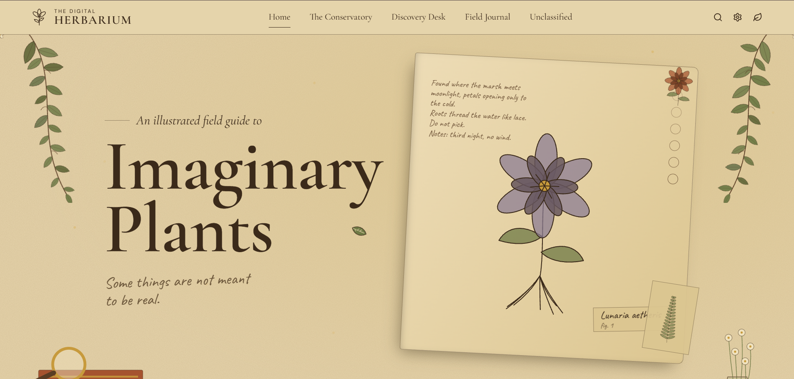
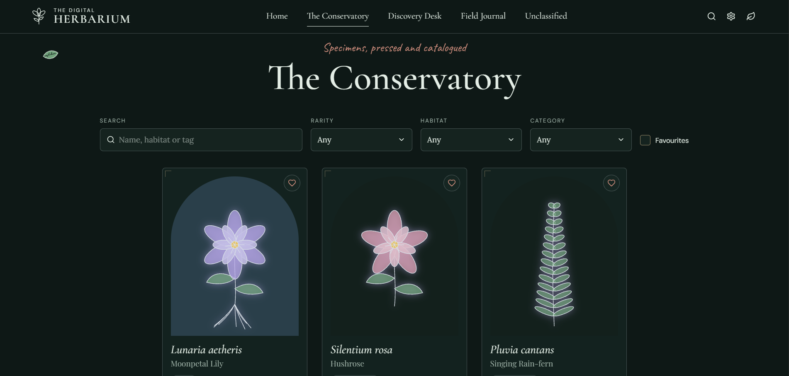
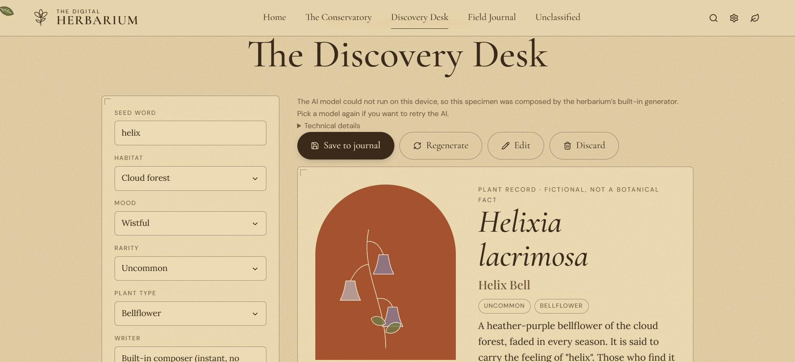
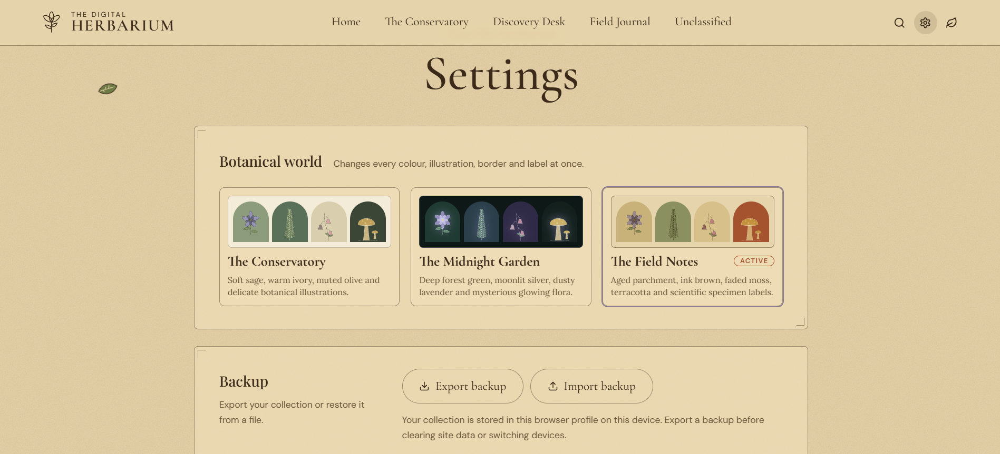
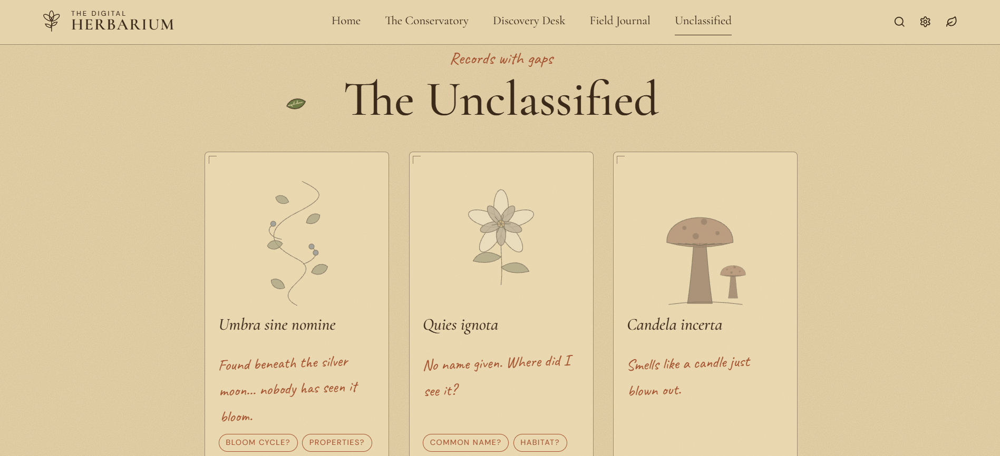

# The Digital Herbarium

*A field guide to plants that never existed, but perhaps should have.*

The Digital Herbarium is an illustrated collection of imaginary botanical species. It is a small digital world where fictional plants have their own names, appearances, habitats, peculiar properties, and stories waiting to be discovered.

Explore a growing conservatory, create entirely new species, keep personal field notes, and uncover botanical records that have yet to be fully classified.

Every species in this herbarium is fictional. Every discovery is an invitation to imagine.

> Not every flower was meant to grow in a garden. Some were meant to grow in stories.

<h3>01 · The Landing Page</h3>
  

---

## Explore the Herbarium

The experience is organised around four spaces, each offering a different way to interact with its fictional botanical world.

### The Conservatory

A home for discovered species. Browse the collection, explore botanical illustrations, and open individual specimen records to learn about their characteristics, habitats, and origins.

  <h3>02 · The Conservatory</h3>
  

### The Discovery Desk

A creative space for inventing new species. Start with a seed word, choose a mood or habitat, and let the in-browser AI help turn an idea into a fictional botanical profile.

Generated entries can be reviewed, edited, regenerated, and saved to your collection.

  <h3>03 · The Discovery Desk</h3>
  

### The Field Journal

A personal archive for your discoveries. Keep observations, add notes, revisit saved species, and mark favourites. Your collection belongs to your browser, so you can build a little herbarium of your own.

  <h3>05 · Settings</h3>
  

### The Unclassified

A collection of mysterious and incomplete botanical records. Explore species with missing details, uncertain origins, and stories that leave room for interpretation.

  <h3>04 · The Unclassified</h3>
  

---

## What You Can Do

- Discover illustrated fictional plant species.
- Generate new botanical concepts using AI.
- Explore species profiles and their imaginary characteristics.
- Browse fictional habitats, rarity levels, folklore, and unusual properties.
- Save discoveries to your personal collection.
- Favourite species and revisit them later.
- Write and maintain personal field observations.
- Explore incomplete and mysterious specimen records.
- Switch between three visual themes.
- Export your collection for safekeeping and import it when needed.

---

## The Botanical Details

Each specimen can have its own collection of fictional characteristics, including:

| Detail | Description |
|---|---|
| Botanical name | A distinctive scientific-style name |
| Common name | What the plant is known as |
| Appearance | Its leaves, petals, roots, colours, and structure |
| Habitat | The imaginary environment where it grows |
| Rarity | How unusual the species is |
| Properties | Its peculiar or extraordinary characteristics |
| Folklore | Stories, legends, and beliefs surrounding it |
| Bloom cycle | When and how it flowers |
| Fragrance | Its imagined scent |
| Specimen ID | A unique identifier for its record |

These details are creative world-building, not real botanical or scientific information.

---

## Technology

The Digital Herbarium is built with a modern frontend stack, with an emphasis on browser-based functionality and local data storage.

| Technology | Purpose |
|---|---|
| React | Component-based user interface |
| Vite | Development environment and build tooling |
| Tailwind CSS | Styling and responsive layouts |
| Motion | Interface animations and transitions |
| React Router | Navigation between sections |
| Transformers.js | Browser-based AI inference |
| Web Workers | Running AI tasks away from the main UI thread |
| WebGPU / WebAssembly | Local model execution |
| IndexedDB | Persistent browser-side storage |
| Lucide React | Interface icons |

---

## AI & Generation

The Discovery Desk uses Transformers.js to run supported AI models directly in the browser through a Web Worker.

- The model is downloaded when needed and cached by the browser.
- WebGPU is used where supported, with WebAssembly as a fallback.
- Generation happens locally rather than through a remote inference API.
- Model availability and performance depend on the browser and device.
- The first model download may take some time and require a substantial amount of storage.

The AI is an optional creative assistant for generating fictional botanical records.

---

## Storage & Privacy

Your personal collection is stored locally in IndexedDB.

This includes:
- Saved species
- Personal observations and notes
- Favourites
- Application settings

There is no account system required to maintain a collection. Your saved data is associated with the browser profile and device where it was created.

**A note about backups:** Clearing browser site data can erase your collection. Use the Export feature in Settings or the Field Journal to create a backup. You can import that backup later.

Local AI inference means prompts are not sent to a remote AI inference service. However, downloading models and other application resources may still require an internet connection.

---

## Themes

The herbarium offers three visual environments:

- **Conservatory** — a soft botanical palette inspired by sage, ivory, and muted greens.
- **Midnight Garden** — a darker atmosphere for a more mysterious botanical experience.
- **Field Notes** — a notebook-inspired theme with an archival feel.

Each theme gives the same collection a different atmosphere.

---

## Botanical Illustrations

The plant artwork is created using procedural SVG illustrations.

The illustrations are generated through reusable components, allowing botanical forms to be composed and varied without requiring a separate image for every species.

Additional artwork and textures can be placed in:

- `public/illustrations/`
- `public/textures/`

---

## Run Locally

Make sure Node.js and npm are installed.

Clone the repository:

```bash
git clone https://github.com/mehroofsaba/Digital-Herbarium.git
cd Digital-Herbarium
```

Install dependencies:

```bash
npm install
```

Start the development server:

```bash
npm run dev
```

Create a production build:

```bash
npm run build
```

Preview the production build locally:

```bash
npm run preview
```

The production build is generated in the `dist/` directory.

---

## Project Structure

```text
digital-herbarium/
├── public/
│   ├── illustrations/
│   ├── textures/
│   └── favicon.svg
├── src/
│   ├── components/
│   ├── data/
│   ├── lib/
│   ├── pages/
│   ├── App.jsx
│   ├── index.css
│   └── main.jsx
├── index.html
├── package.json
├── render.yaml
└── vite.config.js
```

---

## A Little Note

The Digital Herbarium is an exploration of imagination, interface design, browser-based AI, and creative personal collections.

It is not an attempt to catalogue the plants that exist, but to give a home to the ones that don't.

*Happy wandering through the conservatory.*
